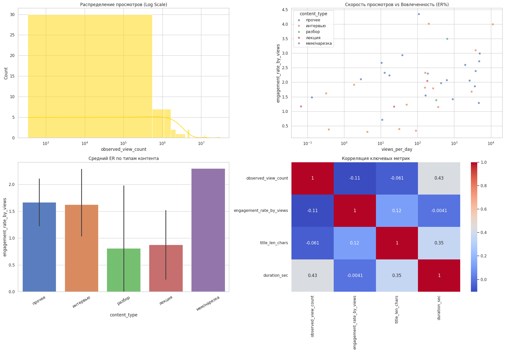

# Tinkoff Media Analytics

Исследовательская аналитика YouTube-контента **об Олеге Тинькове**: поиск видео, анализ каналов, вовлечённости и тональности комментариев. Учебный проект по публичному медиаконтенту; не внутренние данные банка и не официальный продукт Т-Банка.

[Открыть ноутбук](Tinkoff_Media_Analytics.ipynb) · [Открыть в Colab](https://colab.research.google.com/github/Pernya/tinkoff-media-analytics/blob/main/Tinkoff_Media_Analytics.ipynb)



## Что внутри

- Расширение поисковых запросов через Google Suggest, обход графа запросов BFS / DFS.
- Поиск и сбор публичных метаданных видео через `yt-dlp`.
- Обогащение признаками видео и каналов, сбор комментариев и анализ тональности через `blanchefort/rubert-base-cased-sentiment`.
- Мастер-таблица, просмотры в день, engagement rate, доля негативных комментариев и классификация контента по правилам.
- Признаки и выгрузки для дальнейшего анализа в Orange.
- Графики и агрегированные отчёты, сохранённые в исходной работе.

## Как читать результаты

Просмотры, лайки и комментарии — наблюдаемые показатели на момент сбора. Показатели на их основе могут зависеть от пропусков, возраста ролика и состава поисковой выборки.

**Показы, охват и CTR — сценарные оценки**, рассчитанные с допущениями из `CONFIG`. Доступа к внутренней YouTube Analytics у проекта нет. Поисковая выборка не представляет все упоминания человека, а сентимент-модель не проходила отдельную валидацию на размеченных комментариях этого проекта. Негативный комментарий к ролику не обязательно означает негатив к его герою.

Сохранённые графики относятся к исходному сбору, а не к текущему состоянию YouTube.

## Открытие и окружение

Для просмотра результатов достаточно открыть ноутбук на GitHub. Для работы с кодом используйте Colab по ссылке выше или локальный Python 3.10+:

```bash
python -m venv .venv
source .venv/bin/activate  # Windows: .venv\Scripts\activate
python -m pip install -r requirements.txt
jupyter lab Tinkoff_Media_Analytics.ipynb
```

Настройки находятся в `CONFIG`: запросы, глубина обхода, число видео и комментариев, задержки, модель тональности и выходная папка. Модель Transformers загружается при первом использовании; нужны интернет и свободное место. Выгрузки сохраняются в `media_analytics_output/`. Google Drive подключается только при явном `USE_GOOGLE_DRIVE=True` в соответствующей ячейке Colab.

**Статус выполнения:** это исследовательский ноутбук с последовательными исправлениями и переопределениями функций. Исходные ячейки выполнялись не по порядку; успешный Run All с чистого kernel не подтверждён. Для повторного сбора следует сначала привести определения функций и этапы запуска к единой последовательности. Публикация сохраняет эту границу и не представляет файл как готовый автономный сервис.

Повторный сбор зависит от доступности YouTube, Google Suggest, отдельных видео и ограничений сервисов. При публикации сетевой сбор и загрузка модели заново не выполнялись.

## Что опубликовано

- `Tinkoff_Media_Analytics.ipynb` — основной код и сохранённые агрегированные результаты.
- `assets/media_overview.png` — итоговый график из исходного ноутбука.
- `requirements.txt` — зависимости; это диапазоны для установки, не зафиксированное окружение исходного запуска.
- `publication.json` — происхождение и статус проверки.

Сырые комментарии, промежуточные CSV и журналы сбора не включены. Из публичной копии убраны их предварительные табличные выводы, технические widget-данные и progress-логи. Создание внешней Google-таблицы заменено локальным показом агрегатов; локальный запуск не требует подключения Google Drive. Исходный файл сохранён без изменений.

## Проверка

```bash
python -m pip install -r requirements-validation.txt
python scripts/validate.py
```

GitHub Actions проверяет структуру ноутбука и синтаксис code-ячеек. Это не сетевой тест сбора данных и не подтверждение запуска всей аналитики с чистого состояния.
