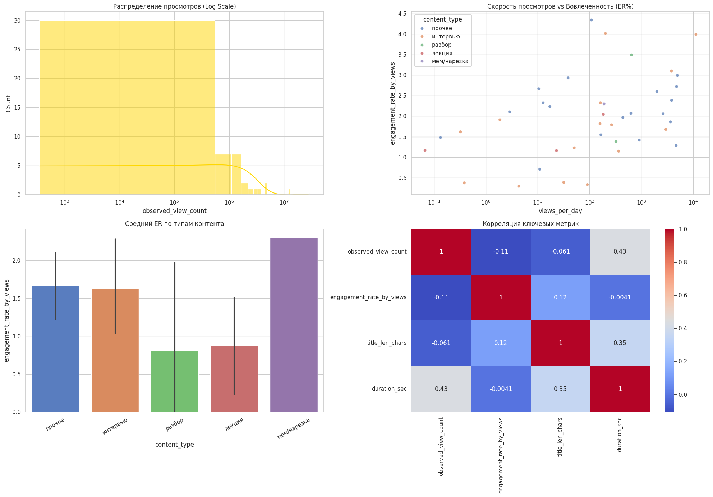

# Медиааналитика — Олег Тиньков в YouTube

[](https://github.com/Pernya/tinkoff-media-analytics/actions/workflows/validate.yml)

Исследование публичных видео: как находить тематический контент, сравнивать просмотры и вовлечённость, а также готовить комментарии к анализу тональности. Учебная работа о медиаконтенте; не внутренние данные и не официальный продукт Т-Банка.

**[Читать ноутбук →](Tinkoff_Media_Analytics.ipynb)** · [Открыть в Colab](https://colab.research.google.com/github/Pernya/tinkoff-media-analytics/blob/main/Tinkoff_Media_Analytics.ipynb) · [Документация](docs/PROJECT_GUIDE.md)

## Что видно в сохранённом срезе

| Показатель | Значение |
|---|---:|
| Видео в основной сводке | **53** |
| Медиана просмотров | **429 542** |
| Средний ER по видео | **1,50%** |
| Видео с рассчитанной скоростью просмотров | **40** |

Это результаты прежнего сбора, а не текущие показатели YouTube. Время единого среза в итогах не зафиксировано. Средний ER — среднее отношений по отдельным видео; он не равен отношению суммарных взаимодействий к суммарным просмотрам.



Скорость просмотров доступна не для всех видео, поэтому состав наблюдений на графиках различается. Логарифмическая шкала помогает увидеть ролики с сильно отличающимся числом просмотров.

## Как устроена работа

1. **Найти контент.** Расширяем исходные запросы через Google Suggest и обходим граф запросов в ширину и глубину.
2. **Собрать метаданные.** Используем `yt-dlp` для поиска роликов, счётчиков и сведений о каналах.
3. **Подготовить признаки.** Рассчитываем вовлечённость и среднюю скорость просмотров, определяем предполагаемый жанр по правилам.
4. **Исследовать комментарии.** Код предусматривает классификацию тональности моделью RuBERT и агрегацию по видео.
5. **Собрать отчёт.** Строим таблицы и графики, сохраняем CSV и признаки для Orange.

**Тональность в итогах:** соответствующие поля отсутствуют в основной сохранённой сводке. Наличие NLP-кода не означает, что по опубликованному результату можно сделать вывод о настроениях аудитории.

## Как понимать метрики

| Метрика | Значение | Что не следует из неё |
|---|---|---|
| Просмотры | Счётчик при сборе | Не уникальный охват людей |
| ER | `(лайки + комментарии) / просмотры × 100%` | Не причинный эффект формата ролика |
| Просмотры в день | Просмотры / возраст ролика | Не скорость набора просмотров сегодня |
| Net sentiment | `(позитивные − негативные) / размеченные комментарии` | Не отношение всей аудитории к герою |
| CTR, показы, охват | Сценарные приближения из `CONFIG` | Не измерения из YouTube Analytics |

Поисковая выдача задаёт выборку и не охватывает все упоминания. Правила жанра и модель тональности могут ошибаться; отдельная ручная проверка разметки в проекте не подтверждена.

## Читать или повторить

**Для знакомства** достаточно открыть ноутбук: в начале есть оглавление, далее — пояснения к этапам и сохранённым результатам.

**Для работы с кодом** используйте Colab или Python 3.10+ локально:

```bash
python -m venv .venv
source .venv/bin/activate  # Windows: .venv\Scripts\activate
python -m pip install -r requirements.txt
jupyter lab Tinkoff_Media_Analytics.ipynb
```

В `CONFIG` задаются запросы, глубина обхода, лимиты видео и комментариев, задержки и выходная папка. Результаты сохраняются в `media_analytics_output/`. Модель Transformers скачивается при первом использовании; Google Drive подключается только при `USE_GOOGLE_DRIVE=True`.

**Режим работы — исследовательский журнал.** Функции последовательно уточнялись, а исходные ячейки выполнялись не по порядку. Run All с чистого kernel пока не подтверждён. Для воспроизведения нужно согласовать определения функций перед их вызовами и заново выполнить сетевой сбор.

## Почему в таблицах встречаются 53 и 40 видео

В исходном файле сохранены разные состояния исследования: основная сводка на 53 видео и отдельный результат обновления на 40. Кроме того, в итоговой сводке из 53 видео скорость просмотров заполнена только для 40.

В ноутбуке эти случаи подписаны отдельно. Разницу средних между таблицами нельзя считать изменением во времени без согласованного списка ID и дат сбора. Для нового исследования сначала зафиксируйте состав выборки и время наблюдения.

## Состав и проверка

Опубликованы главный ноутбук, итоговый график и зависимости. Сырые комментарии, промежуточные CSV и технические журналы не включены. [Происхождение и статус](publication.json).

При редакторской правке сохранены вычисления, порядок code-ячеек и их результаты; улучшены пояснения и форматирование. Полный сетевой сбор не перезапускался. `requirements.txt` задаёт диапазоны зависимостей, а не точное окружение исходного исследования.

**Проверка структуры и синтаксиса:** установите `requirements-validation.txt` и выполните `python scripts/validate.py`. GitHub Actions выполняет ту же проверку; она не подтверждает доступность YouTube или успешный сбор данных.
