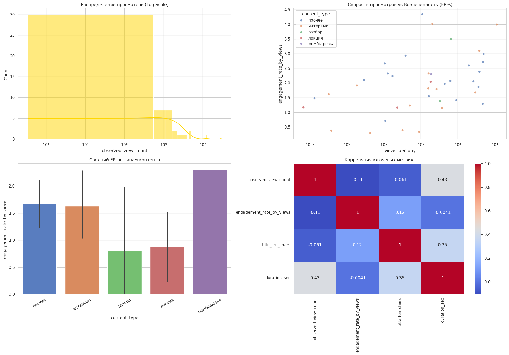
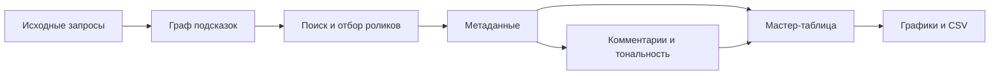

# Руководство по медиааналитике YouTube

[Главная страница](../README.md) · [Ноутбук](../Tinkoff_Media_Analytics.ipynb) · [Открыть в Colab](https://colab.research.google.com/github/Pernya/tinkoff-media-analytics/blob/main/Tinkoff_Media_Analytics.ipynb)

Проект исследует видео об Олеге Тинькове на YouTube. Он показывает, как расширять поисковые запросы, собирать публичные метаданные, рассчитывать вовлечённость и готовить комментарии к анализу тональности.

## Содержание

1. [Результаты и состав выборки](#results)
2. [Источники и структура данных](#data)
3. [Этапы обработки и функции](#architecture)
4. [Определения метрик](#metrics)
5. [Просмотр и повторный сбор](#run)
6. [Настройки](#settings)
7. [Выходные файлы](#outputs)
8. [Проверки и типовые проблемы](#troubleshooting)

<a id="results"></a>

## 1. Результаты и состав выборки

В основной сохранённой сводке **53 видео**, медиана просмотров **429 542**, средняя вовлечённость по роликам **1,50%**. Возраст ролика позволил рассчитать скорость просмотров для **40 из этих 53 видео**. Отдельная таблица обновления содержит **40 видео** и относится к другому состоянию данных. Сопоставление этих таблиц во времени потребовало бы одинаковых идентификаторов и зафиксированных дат наблюдения.

Поисковая выдача ограничивает охват исследования. Результаты описывают найденные ролики, а просмотры отражают состояние счётчиков на момент сбора. Тональность предусмотрена в коде, но соответствующие колонки отсутствуют в основной сохранённой сводке.



<a id="data"></a>

## 2. Источники и структура данных

| Источник | Что используется | Единица наблюдения |
|---|---|---|
| Google Suggest | Связанные поисковые запросы | Переход от исходного запроса к подсказке |
| Поиск YouTube через `yt-dlp` | Идентификаторы, ссылки, позиции, доступные счётчики | Ролик в выдаче по запросу |
| Метаданные YouTube | Сведения о ролике, канале, публикации и взаимодействиях | Ролик |
| Комментарии YouTube | Доступные комментарии и оценки тональности | Комментарий |
| Итоговая таблица | Признаки, метрики, жанр и доступные агрегаты комментариев | Ролик |

Ролик связывается с агрегатами комментариев по `video_id`. При первичном сборе поиск сводится к одной строке на `video_url`, сохраняя число запросов, лучшую и среднюю позицию в выдаче. При обновлении `upsert_data` объединяет старые и новые записи по `video_id` или `comment_id`, оставляя новую запись для совпадающего ключа.

Набор поисковых фраз, время съёма и доступность полей влияют на результат. Для сравнения новых срезов полезно хранить состав роликов и время сбора отдельно. [Памятка по данным](../data/README.md).

<a id="architecture"></a>

## 3. Этапы обработки и функции



| Компонент | Назначение |
|---|---|
| `get_related_queries`, `run_bfs`, `run_dfs`, `build_query_graph` | Получают подсказки и расширяют исходные запросы на заданную глубину |
| `yt_search`, `collect_videos` | Ищут ролики и агрегируют их присутствие по запросам |
| `fetch_video_metadata`, `enrich_videos` | Дополняют поисковые данные детальными метаданными |
| `fetch_comments`, `score_sentiment_batch` | Получают комментарии и размечают их готовой моделью RuBERT |
| `collect_comments_for_videos`, `summarize_comments_by_video` | Собирают комментарии выбранных видео и агрегируют результаты по ролику |
| `add_time_features`, `add_exposure_metrics`, `add_engagement_metrics` | Рассчитывают возраст ролика, признаки просмотров и вовлечённости |
| `build_master_table_complete` | Собирает итоговую таблицу, жанры, контекст и признаки для дальнейшего анализа |
| `load_existing_data`, `upsert_data` | Загружают прежние выгрузки и обновляют строки по ключам |

Ноутбук сохраняет ход исследования. Функции уточнялись в процессе работы, поэтому поздние определения заменяют ранние в текущем kernel. Заголовки показывают, к какому этапу относятся расчёты и сохранённые результаты.

<a id="metrics"></a>

## 4. Определения метрик

| Метрика | Расчёт | Что учитывать |
|---|---|---|
| `observed_view_count` | Счётчик из метаданных, при пропуске используется счётчик поисковой выдачи | Счётчики меняются со временем, просмотры могут повторяться у одного человека |
| `views_per_day` | Просмотры / возраст ролика в днях | Среднее за жизнь ролика, требует даты публикации |
| `engagement_rate_by_views` | 100 × (лайки + комментарии) / просмотры | В позднем расчёте незаполненные счётчики лайков и комментариев заменяются нулями |
| `net_sentiment` | (позитивные − негативные) / число размеченных комментариев | Опирается на доступные комментарии и точность модели |
| `sentiment_negative_share` | Доля негативных среди размеченных комментариев | Может отражать отношение к интервью или обсуждаемым темам |
| `content_type`, `frame_type` | Правила по словам в заголовке и описании | Возможны ошибки автоматической классификации |

Средний ER в сводке рассчитывается по роликам с равным весом. Для объединённой доли взаимодействий по просмотрам понадобилось бы отдельно поделить сумму взаимодействий на сумму просмотров.

Показы и охват рассчитываются по допущениям из `CONFIG`. Код делит просмотры на выбранный CTR, чтобы получить сценарную оценку показов, и на выбранную частоту, чтобы получить сценарную оценку охвата. Фактические показы, охват и CTR из YouTube Analytics в данных отсутствуют.

Колонки для Orange используют пороги из текущей выборки. В полной сборке высокая вовлечённость определяется относительно 75-го процентиля ER, высокая скорость просмотров — относительно 90-го процентиля. Колонка `target_is_high_negative` может состоять из нулей при отсутствующем входном поле тональности. Перед обучением по этим колонкам проверьте наличие исходных метрик и уберите из признаков переменные, по которым вычислена цель.

<a id="run"></a>

## 5. Просмотр и повторный сбор

**Посмотреть результаты** можно сразу в GitHub или Colab. Основные таблицы находятся в разделах 8 и 10, итоговый рисунок доступен выше.

**Открыть код локально** можно с Python 3.10+:

```bash
git clone https://github.com/Pernya/tinkoff-media-analytics.git
cd tinkoff-media-analytics
python -m venv .venv
```

Активируйте окружение через `source .venv/bin/activate` в macOS/Linux или `.venv\Scripts\Activate.ps1` в PowerShell.

```bash
python -m pip install -r requirements.txt
jupyter lab Tinkoff_Media_Analytics.ipynb
```

**Подготовить повторный сбор** можно через настройки в разделе 1 и блок обновления в разделе 9. При первом использовании тональности потребуется скачать модель `blanchefort/rubert-base-cased-sentiment`. Проверьте, что перед блоком сбора доступны последние определения используемых функций, включая `build_master_table_complete`. В сохранённой последовательности первая сборка вызывает `build_master_table` раньше её определения. Полный запуск с чистого kernel и успешный новый сбор для опубликованной редакции пока не подтверждены.

По умолчанию путь содержит имя нового запуска, поэтому для обновления прежнего среза укажите существующую папку в `CONFIG` и сформируйте `PATHS` заново. В Colab можно включить `USE_GOOGLE_DRIVE=True`, чтобы блок сохранения направил файлы в постоянную папку. Для истории измерений делайте копию прежних CSV перед обновлением. Upsert хранит последнюю запись по ключу, поэтому прошлые значения счётчиков в той же таблице заменяются.

<a id="settings"></a>

## 6. Настройки

| Настройка в `CONFIG` | Значение по умолчанию | Роль |
|---|---|---|
| `seed_queries`, `start_keyword` | Запросы об Олеге Тинькове | Тема и начальные фразы |
| `bfs_depth`, `dfs_depth` | 2 и 3 | Глубина обхода подсказок |
| `query_suggest_limit_graph`, `query_suggest_limit_search` | 3 и 5 | Лимиты подсказок |
| `search_limit_per_query` | 15 | Размер выдачи на запрос |
| `max_enrich_videos` | 40 | Объём детального обогащения |
| `max_comments_per_video` | 150 | Лимит, передаваемый первой сборкой в функцию комментариев |
| `min_duration_seconds`, `max_duration_seconds` | 0 и 14 400 | Допустимая длительность |
| `min_views_threshold` | 0 | Порог просмотров |
| `request_sleep_min`, `request_sleep_max` | 0,4 и 1,0 секунды | Паузы при вызове `safe_sleep` |
| `assumed_ctr_values`, `assumed_frequency_values` | 2%, 4%, 6% и 1,2, 1,5, 2,0 | Сценарные коэффициенты |
| `out_dir`, `run_name` | `media_analytics_output`, имя с отметкой времени | Выходной каталог |
| `sentiment_model` | `blanchefort/rubert-base-cased-sentiment` | Модель тональности |

Некоторые этапы передают параметры явно, другие используют значения функций по умолчанию. При изменении лимитов сверяйте конкретный вызов в выбранном блоке.

<a id="outputs"></a>

## 7. Выходные файлы

| Файл | Содержание |
|---|---|
| `query_graph.csv` | Связи между запросами, сохранённые при первой сборке |
| `videos_raw.csv` | Результаты поиска и сведения о присутствии в выдаче |
| `comments_raw.csv` | Собранные комментарии и доступные результаты обработки |
| `comment_summary_by_video.csv` | Агрегаты комментариев по роликам |
| `videos_master.csv` | Итоговые метрики, жанры и аналитические признаки |
| `run_log.json` | Настройки и журнал первой сборки |
| `orange_viral.csv`, `orange_engagement.csv`, `orange_negative.csv` | Дополнительные выгрузки соответствующих исследовательских ячеек |

Имена и наличие файлов зависят от выполненных ячеек. Путь `channel_snapshots.csv` зарезервирован в `PATHS`. Для получения выгрузки понадобится вызвать `collect_channel_snapshots` и сохранить возвращённую таблицу. Обновление перенаправляет основные файлы при включённом Drive, а часть выгрузок Orange обращается напрямую к `RUN_DIR`.

В GitHub доступны агрегированные результаты и код. Сырые комментарии и рабочие CSV сохраняются локально или в указанной папке Drive.

<a id="troubleshooting"></a>

## 8. Проверки и типовые проблемы

| Симптом | Что проверить |
|---|---|
| Поиск вернул пустой набор | Сообщения `yt-dlp`, доступность YouTube, исходные запросы и лимиты |
| `NameError` или отсутствует функция сборки | Определения функций в текущем kernel и порядок выбранного маршрута |
| `KeyError` по метрике | Названия полей и наличие данных предыдущего этапа |
| Нет тональности | Есть ли доступные комментарии, загрузилась ли модель и присоединились ли агрегаты по `video_id` |
| Нет просмотров в день | Заполненность и формат даты публикации |
| Новый состав отличается от сохранённого | Даты сбора, запросы, фильтры и доступность видео |
| Старые выгрузки не подхватились | `RUN_DIR`, значения `PATHS` и ключи `video_id`, `comment_id` |

Перед чтением новой сводки проверьте количество строк, дубликаты ключей, заполненность исходных счётчиков и покрытие каждой метрики. Сравнивайте значения на одинаковых наблюдениях.

Структуру ноутбука и синтаксис можно проверить локально:

```bash
python -m pip install -r requirements-validation.txt
python scripts/validate.py
```

Эту проверку выполняет и GitHub Actions. Проверка сетевого сбора и пересчёт результатов требуют отдельного выполнения с доступом к источникам.
